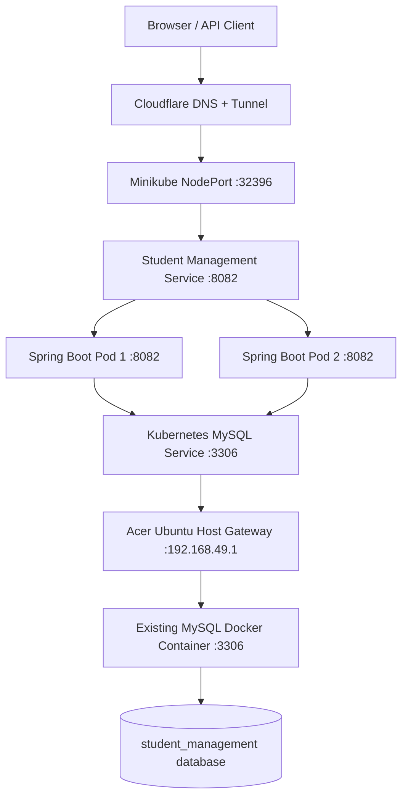

# Student Management – Backend

A Spring Boot REST API for managing student records. This repository currently contains **the backend only**. The React frontend is not part of this Git repository or deployment yet.

The backend is packaged as a Docker image, pushed to Docker Hub, and deployed to a single-node Minikube Kubernetes cluster on an Ubuntu homelab server. It connects to the existing MySQL Docker container without recreating the database container or its data.

## 1. Project Architecture



### Technology Stack

| Component | Technology |
|---|---|
| Backend | Spring Boot 3.5.7 |
| Programming Language | Java 21 |
| Build Tool | Maven |
| Database | MySQL 9.7 |
| Containerization | Docker |
| Container Orchestration | Kubernetes |
| Kubernetes Distribution | Minikube |
| API Documentation | SpringDoc OpenAPI / Swagger |
| Public Access | Cloudflare Tunnel |
| Server OS | Ubuntu 24.04 |

### Deployment Configuration

| Configuration | Value |
|---|---|
| Docker Hub Image | `callmee6/student-management:1.0` |
| Kubernetes Deployment | `student-management-deployment` |
| Replicas | 2 |
| Kubernetes Service | `student-management-service` |
| Service Type | NodePort |
| NodePort | `32396` |
| Application Port | `8082` |
| Minikube IP | `192.168.49.2` |
| MySQL Service | `mysql:3306` |
| Acer Host Gateway | `192.168.49.1` |
| MySQL Host Port | `3307` |
| Database Name | `student_management` |
| Public Domain | `student-mgmt.rohitnet.dpdns.org` |

## 2. Repository Structure

```text
student-management/
└── backend/
    ├── src/
    │   └── main/
    │       ├── java/
    │       │   └── com/example/studentmanagement/
    │       │       ├── controller/
    │       │       ├── service/
    │       │       ├── repository/
    │       │       ├── model/
    │       │       ├── exception/
    │       │       └── StudentManagementApplication.java
    │       └── resources/
    │           └── application.properties
    ├── Dockerfile
    ├── deploymentservice.yaml
    ├── mysql-service.yaml
    └── pom.xml
```

The frontend will be integrated into this repository in a future phase.

## 3. Application Configuration

File: `src/main/resources/application.properties`

```properties
spring.application.name=student-management

server.port=8082
server.forward-headers-strategy=framework

spring.datasource.url=jdbc:mysql://mysql:3306/student_management
spring.datasource.username=root
spring.datasource.password=${DB_PASSWORD}
spring.datasource.driver-class-name=com.mysql.cj.jdbc.Driver

spring.jpa.hibernate.ddl-auto=update
spring.jpa.show-sql=true
spring.jpa.open-in-view=false
spring.jpa.properties.hibernate.format_sql=true
```

The database password is supplied through the `DB_PASSWORD` environment variable.

**Important:** Never commit database passwords, Cloudflare Tunnel tokens, or other sensitive credentials to GitHub.

## 4. Build the Spring Boot Application

Navigate to the backend directory:

```bash
cd backend
```

Build the application using Maven:

```bash
mvn clean package
```

To skip tests:

```bash
mvn clean package -DskipTests
```

Verify the generated JAR:

```bash
ls -lh target/*.jar
```

## 5. Docker Image Creation

### Dockerfile

```dockerfile
FROM maven:3.9-eclipse-temurin-21 AS build

WORKDIR /app
COPY pom.xml .
COPY src ./src

RUN mvn clean package -DskipTests

FROM eclipse-temurin:21-jre

WORKDIR /app
COPY --from=build /app/target/student-management-0.0.1-SNAPSHOT.jar app.jar

EXPOSE 8082

ENTRYPOINT ["java", "-jar", "app.jar"]
```

### Build Docker Image

```bash
docker build -t student-management:1.0 .
```

Verify the image:

```bash
docker images
```

### Tag Image for Docker Hub

```bash
docker tag student-management:1.0 callmee6/student-management:1.0
```

### Login to Docker Hub

```bash
docker login
```

### Push Image

```bash
docker push callmee6/student-management:1.0
```

The image is now available in Docker Hub and can be pulled by Kubernetes.

Docker Hub repository:

`callmee6/student-management`

## 6. MySQL Docker Network and Kubernetes Connectivity

The MySQL database was already running as a Docker container on the Acer Ubuntu server.

Existing Docker networks:

| Network | MySQL Container IP |
|---|---|
| `spring-net` | `172.18.0.2` |
| `student-network` | `172.19.0.3` |

The MySQL container publishes its port as follows:

```text
Acer Host: 3307
MySQL Container: 3306
```

Inspect the Docker network configuration:

```bash
docker inspect mysql
```

Check the published port:

```bash
sudo ss -lntp | grep 3307
```

### Problem

Kubernetes Pods cannot automatically resolve Docker container hostnames because Docker networks and Kubernetes networking are separate.

Therefore, the Kubernetes application needs another way to access the existing MySQL container.

The solution is to expose the existing MySQL container through the Acer host gateway and create a Kubernetes Service.

### Test Connectivity from Kubernetes

```bash
kubectl run mysql-connect-test \
  --image=busybox:1.36 \
  --restart=Never \
  --command -- sleep 300
```

Check the Pod:

```bash
kubectl get pods
```

Test connectivity:

```bash
kubectl exec mysql-connect-test -- nc -vz 192.168.49.1 3307
```

Expected output:

```text
192.168.49.1 (192.168.49.1:3307) open
```

Delete the temporary test Pod:

```bash
kubectl delete pod mysql-connect-test
```

### mysql-service.yaml

Create a Kubernetes Service and Endpoints object to connect the application Pods to the existing MySQL Docker container.

```yaml
apiVersion: v1
kind: Service
metadata:
  name: mysql
spec:
  ports:
    - protocol: TCP
      port: 3306
      targetPort: 3307

---
apiVersion: v1
kind: Endpoints
metadata:
  name: mysql
subsets:
  - addresses:
      - ip: 192.168.49.1
    ports:
      - port: 3307
        protocol: TCP
```

Apply the configuration:

```bash
kubectl apply -f mysql-service.yaml
```

Verify:

```bash
kubectl get svc mysql
kubectl get endpoints mysql
```

The application can now connect using:

```text
jdbc:mysql://mysql:3306/student_management
```

The existing MySQL Docker container and its persistent database data remain unchanged.

## 7. Kubernetes Deployment

### deploymentservice.yaml

Create the Kubernetes Deployment with two replicas and expose the application using a NodePort Service.

```yaml
apiVersion: apps/v1
kind: Deployment
metadata:
  name: student-management-deployment
spec:
  replicas: 2
  selector:
    matchLabels:
      app: student-management
  template:
    metadata:
      labels:
        app: student-management
    spec:
      containers:
        - name: student-management
          image: callmee6/student-management:1.0
          imagePullPolicy: Always
          ports:
            - containerPort: 8082

---
apiVersion: v1
kind: Service
metadata:
  name: student-management-service
spec:
  selector:
    app: student-management
  ports:
    - protocol: TCP
      port: 8082
      targetPort: 8082
  type: NodePort
  nodePort: 32396
```

### Apply Kubernetes Configuration

```bash
kubectl apply -f deploymentservice.yaml
```

### Check Deployment

```bash
kubectl get deployments
```

### Check Pods

```bash
kubectl get pods -o wide
```

### Check Services

```bash
kubectl get services
```

### Check Application Logs

```bash
kubectl logs deployment/student-management-deployment \
  --all-pods=true \
  --tail=100
```

### Verify Rollout

```bash
kubectl rollout status deployment/student-management-deployment
```

Expected deployment state:

```text
2 Pods Running and Ready
```

## 8. Testing the Kubernetes Application

Get the Minikube IP:

```bash
minikube ip
```

Expected:

```text
192.168.49.2
```

Check the NodePort:

```bash
kubectl get svc student-management-service
```

Access the backend API:

```bash
curl http://192.168.49.2:32396/api/students
```

Example response:

```json
[
  {
    "id": 2,
    "name": "rohit",
    "email": "rohit@example.com",
    "age": 100,
    "course": "CSE"
  }
]
```

This verifies that:

- The Kubernetes NodePort is reachable.
- The request reaches the Spring Boot application.
- The application can communicate with MySQL.
- Student records can be retrieved from the database.

## 9. Cloudflare Tunnel Configuration

The application is intended to be publicly accessible through:

```text
https://student-mgmt.rohitnet.dpdns.org
```

Cloudflare Tunnel provides public HTTPS access without requiring direct public exposure of the Acer server's private IP address.

### Configure Public Hostname

Open the Cloudflare Zero Trust Dashboard.

Navigate to:

```text
Networks → Tunnels
```

Select the existing tunnel used for application hosting.

Configure the public hostname:

| Setting | Value |
|---|---|
| Hostname | `student-mgmt.rohitnet.dpdns.org` |
| Service Type | HTTP |
| Origin URL | `http://192.168.49.2:32396` |

Save the configuration.

**Important:** The Cloudflare Tunnel origin must point to the Kubernetes NodePort if the intention is to expose the Kubernetes deployment.

If the existing hostname still points to a standalone Docker container, update its origin accordingly.

### Test Local Kubernetes Access

```bash
curl http://192.168.49.2:32396/api/students
```

### Test Public Access

```bash
curl -i https://student-mgmt.rohitnet.dpdns.org/api/students
```

A successful response confirms that the public hostname can reach the backend API.

The Cloudflare connector must be running on a machine that can access the configured origin.

## 10. Swagger API Documentation

SpringDoc OpenAPI is used to generate API documentation.

OpenAPI JSON:

```text
https://student-mgmt.rohitnet.dpdns.org/v3/api-docs
```

Swagger UI:

```text
https://student-mgmt.rohitnet.dpdns.org/swagger-ui/index.html
```

Swagger provides an interactive interface to inspect and test the backend REST endpoints.

If Swagger displays a network or CORS error, verify the API using `curl` and check the Cloudflare origin configuration.

## 11. Git and GitHub Commands

Check repository status:

```bash
git status
```

Stage backend changes:

```bash
git add backend/
```

Commit changes:

```bash
git commit -m "Deploy student management backend using Docker and Kubernetes"
```

Push to GitHub:

```bash
git push origin main
```

If the remote repository contains commits that are missing locally:

```bash
git pull --rebase origin main
git push origin main
```

## 12. Updating the Application

Whenever backend source code changes, rebuild the JAR:

```bash
mvn clean package
```

Build the updated Docker image:

```bash
docker build -t student-management:1.0 .
```

Tag the image:

```bash
docker tag student-management:1.0 callmee6/student-management:1.0
```

Push it:

```bash
docker push callmee6/student-management:1.0
```

Restart the Kubernetes Deployment:

```bash
kubectl rollout restart deployment student-management-deployment
```

Wait for the rollout:

```bash
kubectl rollout status deployment student-management-deployment
```

Verify the Pods:

```bash
kubectl get pods -o wide
```

For production-style versioning, prefer publishing a new image tag such as `1.1` and updating the Kubernetes Deployment to use that version rather than repeatedly overwriting the same tag.

## 13. Useful Kubernetes and Docker Commands

### Kubernetes

```bash
# Get deployments
kubectl get deployments

# Get Pods
kubectl get pods -o wide

# Get Services
kubectl get services

# Get MySQL endpoints
kubectl get endpoints mysql

# View application logs
kubectl logs deployment/student-management-deployment \
  --all-pods=true --tail=100

# Restart application
kubectl rollout restart deployment student-management-deployment

# Check rollout status
kubectl rollout status deployment student-management-deployment

# Describe a Pod
kubectl describe pod <pod-name>

# Check Minikube IP
minikube ip

# Test application
curl http://$(minikube ip):32396/api/students
```

### Docker

```bash
# List running containers
docker ps

# Inspect MySQL container
docker inspect mysql

# View MySQL logs
docker logs --tail=100 mysql

# List Docker networks
docker network ls

# Inspect Docker network
docker network inspect spring-net

# List Docker images
docker images
```

## 14. Current Deployment Status

- [x] Spring Boot REST API developed.
- [x] Maven application packaged.
- [x] Docker image created.
- [x] Docker image pushed to Docker Hub.
- [x] Existing MySQL Docker container reused.
- [x] Kubernetes MySQL Service configured.
- [x] Kubernetes Deployment created.
- [x] Two backend replicas deployed.
- [x] Kubernetes NodePort configured.
- [x] Backend API tested through Minikube NodePort.
- [x] Database connectivity verified through application logs.
- [ ] Verify Cloudflare public-hostname routing to the Kubernetes NodePort.
- [ ] Integrate and deploy the React frontend.
- [ ] Implement CI/CD automation.

## 15. Future Improvements

1. Integrate the React frontend into the repository.
2. Implement authentication and role-based authorization.
3. Configure Kubernetes Secrets for database credentials.
4. Implement automated testing with JUnit and Mockito.
5. Introduce Jenkins-based CI/CD pipelines.
6. Automate Docker image builds and pushes.
7. Automate Kubernetes deployments.
8. Implement application monitoring and centralized logging.
9. Configure production-ready resource requests and limits.
10. Improve deployment security and reliability.

---

**Project:** Student Management System  
**Backend:** Spring Boot REST API  
**Deployment:** Docker + Kubernetes (Minikube)  
**Database:** Existing MySQL Docker Container  
**Hosting:** Ubuntu Homelab + Cloudflare Tunnel  
**Container Registry:** Docker Hub
